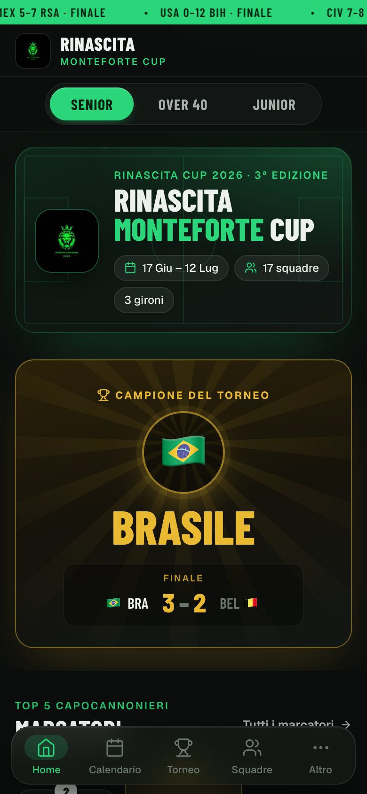
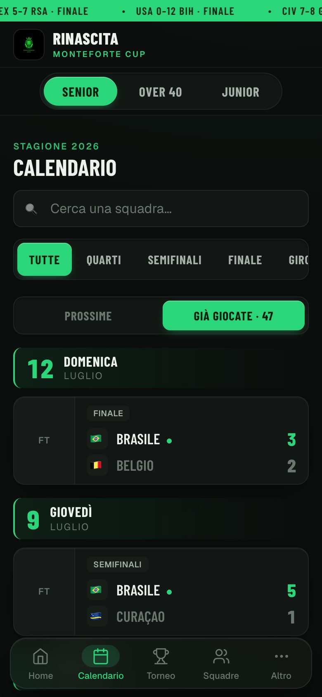
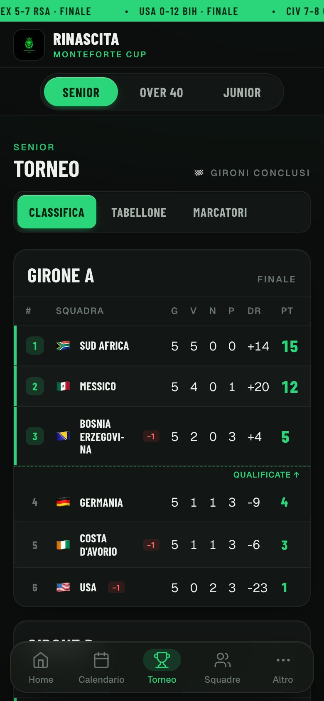
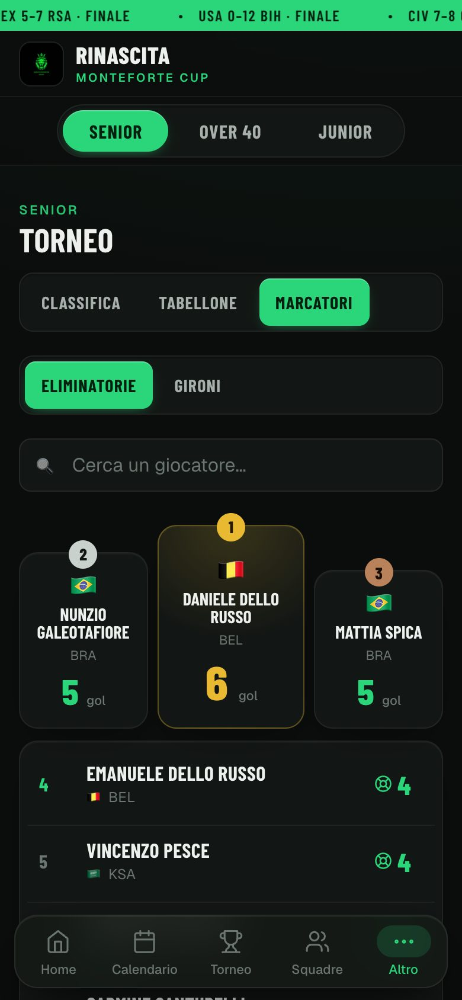
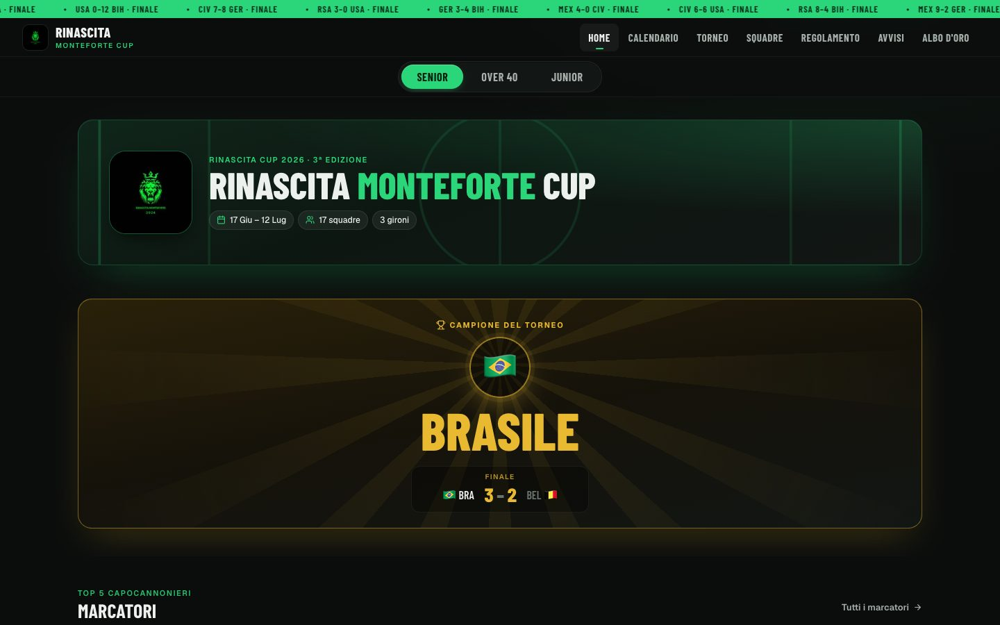

# Rinascita Monteforte Cup

[](https://github.com/Pasqualeim/RinascitaMonteforteIrpino/actions/workflows/ci.yml)
[](./LICENSE)
[](https://react.dev)
[](https://vite.dev)
[](https://supabase.com)

Sito ufficiale per il torneo di calcio amatoriale **"Rinascita Monteforte Cup"** (Monteforte Irpino, AV), con una parte pubblica per i tifosi e un pannello admin riservato allo staff organizzativo.

Il progetto pubblica in tempo quasi reale calendario, risultati, classifiche, live match, marcatori, avvisi, sponsor e contenuti editoriali del torneo, mantenendo un frontend completamente client-side con persistenza dati su Supabase (modello relazionale + fallback legacy).

> 🔗 **Sito live:** **[rinascitamonteforteirpino.netlify.app](https://rinascitamonteforteirpino.netlify.app)** · **Pannello staff:** [`/admin.html`](https://rinascitamonteforteirpino.netlify.app/admin.html)

## Anteprima

Il sito pubblico è progettato **mobile-first**: la maggior parte dei tifosi lo consulta dal telefono a bordo campo.

| Home | Calendario | Torneo | Marcatori |
|:---:|:---:|:---:|:---:|
|  |  |  |  |



> 🔗 Provalo dal vivo su **[rinascitamonteforteirpino.netlify.app](https://rinascitamonteforteirpino.netlify.app)**.

## Indice

- [Panoramica](#panoramica)
- [Funzionalità](#funzionalità)
- [Design e UI](#design-e-ui)
- [Stack tecnologico](#stack-tecnologico)
- [Architettura applicativa](#architettura-applicativa)
- [Struttura del progetto](#struttura-del-progetto)
- [Modello dati e persistenza](#modello-dati-e-persistenza)
- [Database Supabase](#database-supabase)
- [Edge Function `admin-api`](#edge-function-admin-api)
- [Variabili d'ambiente](#variabili-dambiente)
- [Avvio locale](#avvio-locale)
- [Build, preview e deploy](#build-preview-e-deploy)
- [Testing e qualità](#testing-e-qualità)
- [Estensione del progetto](#estensione-del-progetto)
- [Licenza](#licenza)
- [Crediti](#crediti)

## Panoramica

L'applicazione è composta da due entrypoint principali:

- `index.html` — portale pubblico consultabile dai tifosi.
- `admin.html` — area staff protetta da login.

Lato frontend il progetto usa **React 18** con moduli ES e **Vite** come dev server e build tool (configurazione multi-page). Non esiste un server applicativo dedicato: la parte remota è delegata a **Supabase** per lettura dati, autenticazione staff e una **Edge Function** custom (`admin-api`).

## Funzionalità

### Area pubblica

- **Home** adattiva allo stato del torneo: pre-torneo con hero e countdown; a torneo in corso banner dell'edizione e *now card* (diretta live o prossima partita); il giorno della finale hero oro "Finalissima" e, a fischio finale, **banner del campione** con il risultato; poi partite del giorno, classifiche per girone, podio marcatori, bacheca avvisi e premi.
- **Live** — tabellone della partita in diretta con punteggio, minuto ed eventi.
- **Calendario** — partite raggruppate per data in stile *fixture* (stato/orario a sinistra, squadre impilate, vincente in evidenza), filtri per fase e girone, ricerca per squadra, switch "Prossime / Già giocate".
- **Torneo** — pagina con tab interni: Classifica (auto-calcolata, qualificate evidenziate), Tabellone qualificazione ("Come ci si qualifica"), Marcatori.
- **Marcatori** — podio dei primi tre e classifica completa, con ricerca; liste separate eliminatorie (ufficiale) e gironi.
- **Squadre** — elenco filtrabile per girone, con nazione e flag (FIFA 2026) e rosa in dettaglio.
- **Regolamento**, **Avvisi**, **Albo d'oro** delle edizioni passate.

Funzionalità trasversali: refresh automatico dei dati ogni 30 secondi, refresh on-visibility al ritorno sulla tab, dettaglio partita con cronaca e rose, navigazione responsive (header desktop / bottom nav flottante su mobile con drawer "Altro"), striscia ticker superiore, badge LIVE quando c'è una diretta.

### Area admin

Pannello pensato per gestire il torneo durante setup, giornata e post-partita:

- login staff via Edge Function, con sessione breve in `sessionStorage`;
- selettore categoria (Senior / Over 40 / Junior…) per operare sul torneo attivo;
- gestione gironi, squadre (con iscrizioni), partite (gironi + eliminatorie), tabellone di qualificazione;
- **classifica per girone auto-calcolata** con tiebreak sugli scontri diretti, penalità punti e override manuale dell'ordine;
- **live match**: timer, fasi, punteggio +/−, eventi (gol/cartellini) con undo, doppio giallo → rosso automatico;
- gestione marcatori (liste separate gironi / eliminatorie);
- CRUD news, eventi, albo d'oro, sponsor, ticker;
- impostazioni: cambio credenziali, gestione edizioni/categorie, migrazione dati dal blob legacy al modello relazionale.

## Design e UI

Il design del sito pubblico è definito da un livello di token in testa a `src/styles.css`, caricato **solo** dal sito pubblico: il pannello admin continua a usare `colors_and_type.css` senza modifiche.

| Elemento | Scelta |
|----------|--------|
| Sfondo | nero caldo `#0B0D0C` con superfici a livelli (`--bg-surface`, `--bg-raised`, `--bg-hover`) al posto dei bordi marcati |
| Colori | verde brand `#2BD67B` e oro trofeo `#E8B931`, desaturati rispetto al logo per non affaticare la lettura |
| Tipografia | **Barlow Condensed** per titoli, squadre e punteggi; **Geist** per i testi; cifre tabellari su risultati e classifiche |
| Componenti | partite in stile fixture, podio marcatori, banner campione, chip informativi, controlli segmentati uniformi |

Accorgimenti di qualità:

- **mobile-first** e verificato a 320, 360, 390 e 430 px: nessun elemento tagliato o fuori schermo, nomi lunghi su più righe con sillabazione italiana;
- target touch di almeno 40 px, focus ring visibile per la tastiera, rispetto di `prefers-reduced-motion`;
- su desktop (≥ 900 px) layout a contenitore centrato e partite su due colonne.

## Stack tecnologico

| Ambito | Tecnologie |
|--------|------------|
| Frontend | React 18, React DOM, Vite 6 (multi-page), CSS mobile-first (font Barlow Condensed + Geist) |
| Backend | Supabase (Postgres + RLS), Edge Function Deno/TypeScript |
| Client dati | `@supabase/supabase-js` |
| Qualità | Vitest, ESLint, Prettier, GitHub Actions (CI) |
| Deploy | Netlify (build statico) |

## Architettura applicativa

Quattro livelli principali.

### 1. Entry HTML

- `index.html` monta l'app pubblica (`src/public/app.jsx`).
- `admin.html` monta l'app admin (`src/admin/app.jsx`).
- Entrambi condividono il design system base in `colors_and_type.css`; il sito pubblico lo ridefinisce con i propri token in `src/styles.css`.

### 2. Layer di presentazione

- `src/public/*` — schermate e shell del sito pubblico.
- `src/admin/*` — schermate e shell del pannello staff.
- `src/components.jsx` — componenti condivisi (header, footer, bottom nav, live board, ticker, icone).
- `src/styles.css` / `src/admin-styles.css` — stili pubblico (token tema + componenti) e admin.

### 3. Layer dominio

`src/domain.js` contiene la logica pura e riusabile: normalizzazione del payload torneo, compatibilità con lo schema legacy, calcolo classifiche (con tiebreak scontri diretti), derivazione di partite del giorno e ticker, validazione della sessione admin. È il layer più coperto dai test automatici.

### 4. Layer dati

`src/data.js` (con gli helper in `src/lib/*`) gestisce default locali, caricamento dati da Supabase con fallback, persistenza in `localStorage`, autenticazione admin, salvataggio remoto e metodi CRUD verso la Edge Function.

## Struttura del progetto

```text
.
├── index.html                  # entry sito pubblico
├── admin.html                  # entry pannello staff
├── vite.config.js              # config Vite multi-page
├── netlify.toml                # config deploy statico
├── colors_and_type.css         # design system (variabili CSS)
├── src/
│   ├── components.jsx          # componenti pubblici condivisi
│   ├── styles.css / admin-styles.css
│   ├── domain.js               # logica di dominio pura (testata)
│   ├── data.js                 # persistenza, auth, client Supabase
│   ├── lib/                    # api, auth, http, crud, storage, session, migration
│   ├── public/
│   │   ├── app.jsx
│   │   └── screens/            # home, live, calendar, table, teams, scorers, secondary, registrations
│   ├── admin/
│   │   ├── app.jsx · auth.jsx · shared.jsx
│   │   └── sections/           # dashboard, live, matches, standings, teams, gironi,
│   │                           # scorers, bracket, news, content, settings, ...
│   └── __tests__/
│       └── domain.test.js
├── supabase/
│   ├── admin_auth_setup.sql
│   ├── site_data_hardening.sql
│   └── functions/admin-api/    # index.ts + _lib/ + handlers/ (Edge Function)
├── docs/                       # manuale staff + screenshot del README
└── assets/                     # logo e locandine del torneo
```

## Modello dati e persistenza

Il progetto vive in modalità ibrida: supporta sia il vecchio blob JSON singolo, sia un modello relazionale su Supabase.

### Ordine di lettura (`rmLoadData()`)

1. bootstrap relazionale via `admin-api/bootstrap`;
2. se non popolato, tabella `public.site_data` (blob legacy);
3. se la lettura remota fallisce, `localStorage`;
4. in ultima istanza, i default hardcoded in `src/data.js`.

### Ordine di salvataggio (`rmSaveData()`)

1. normalizzazione dei dati;
2. salvataggio immediato in `localStorage` (feedback istantaneo);
3. se pagina admin con sessione valida, invio del payload alla Edge Function.

### Storage browser

- `localStorage.rm_data_v2` — cache e fallback dati torneo;
- `localStorage.rm_team_id_map_v1` — mapping `short → uuid` usato in migrazione;
- `sessionStorage.rm_admin_session_v1` — sessione staff con token ed expiry.

## Database Supabase

### Blob legacy

- `public.site_data` — riga singola `id = 1`, contenuto del sito come `jsonb`, usata come fallback compatibile.

### Modello relazionale (schema v3)

La Edge Function `admin-api` legge e scrive su: `editions`, `tournaments`, `groups`, `knockout_ties`, `teams`, `team_registrations`, `matches`, `match_events`, `live_match_state`, `scorers`, `news`, `edition_events`, `honors`, `sponsors`, `strip_messages`, più la `standings_view` per le classifiche aggregate. Le classifiche sono calcolate lato SQL e riordinate (a pari punti) con la stessa logica di tiebreak lato server e lato client.

### Auth staff e sicurezza

- `supabase/admin_auth_setup.sql` — crea `admin_users` / `admin_sessions`, indici, trigger `updated_at`, RLS con blocco totale per `anon`/`authenticated`.
- `supabase/site_data_hardening.sql` — `SELECT` pubblico limitato alla riga `id = 1`, scrittura consentita solo via service role (quindi solo dalla Edge Function).

> **Nota:** il repository include gli script SQL per auth staff e hardening, ma non tutti gli script di creazione dello schema relazionale principale (`editions`, `tournaments`, `matches`, `standings_view`, …): tali oggetti vanno provisionati sul progetto Supabase.

## Edge Function `admin-api`

`supabase/functions/admin-api/` è organizzata in `index.ts` (router), `_lib/` (db, session, bootstrap, helpers) e `handlers/` (auth, competition, content, editions, legacy).

- **Pubblici:** `GET /bootstrap`, `GET /editions`
- **Auth:** `POST /login`, `GET /me`, `POST /logout`, `POST /credentials`
- **Legacy:** `POST /save`
- **CRUD dominio:** edizioni, categorie, gironi, tabellone qualificazione, squadre, iscrizioni, partite, eventi partita, live state, marcatori, news, eventi, albo d'oro, sponsor, ticker.

### Sessione staff (custom, non Supabase Auth)

1. login con `username` + `password`;
2. verifica dell'hash password in `admin_users`;
3. emissione token random, salvataggio del solo **hash** del token in `admin_sessions`;
4. invio del token raw al browser, persistenza in `sessionStorage`.

## Variabili d'ambiente

### Frontend (Vite)

Copiare `.env.example` in `.env` e valorizzare:

```bash
VITE_SUPABASE_URL=https://your-project.supabase.co
VITE_SUPABASE_KEY=your-anon-key          # chiave anon PUBBLICA (protetta da RLS)
VITE_ADMIN_API_URL=https://your-project.supabase.co/functions/v1/admin-api
```

Senza queste variabili il sito mostra comunque i default locali, ma autenticazione admin e sync remoto non funzionano.

### Edge Function

```bash
SUPABASE_URL=...
SUPABASE_SERVICE_ROLE_KEY=...            # segreto lato server — MAI nel client
ADMIN_SESSION_SECRET=...                 # segreto per hashare i token di sessione
ADMIN_SESSION_HOURS=12
ADMIN_ALLOWED_ORIGIN=https://your-domain.example
```

> Il file `.env` è escluso da git (`.gitignore`). Nel repository è versionato solo `.env.example` con placeholder.

## Avvio locale

**Prerequisiti:** Node.js 20+, npm.

```bash
npm install
cp .env.example .env      # poi compilare le variabili Vite
npm run dev
```

Entrypoint locali:

- sito pubblico → `http://localhost:5173/index.html`
- area admin → `http://localhost:5173/admin.html`

Per un'esperienza completa servono anche: progetto Supabase attivo, Edge Function `admin-api` deployata, tabelle `admin_users`/`admin_sessions` create con almeno un utente staff e (per il bootstrap v3) lo schema relazionale già presente. In assenza di questi, il sito pubblico continua a funzionare con dati locali/default mentre login e salvataggio remoto restano indisponibili.

## Build, preview e deploy

```bash
npm run build     # output in dist/ (dist/index.html + dist/admin.html)
npm run preview   # serve la build localmente
```

Il file `netlify.toml` configura build (`npm run build`), publish directory (`dist`) e Node 20 → deploy statico su Netlify o piattaforme equivalenti. La pipeline **GitHub Actions** (`.github/workflows/ci.yml`) esegue lint, test e build a ogni push/PR su `main`.

## Testing e qualità

```bash
npm run test          # Vitest (una volta)
npm run test:watch    # watch mode
npm run test:ui       # UI di Vitest
npm run lint          # ESLint
npm run format        # Prettier
```

I test coprono il layer di dominio: normalizzazione team/gironi, compatibilità schema, calcolo classifica, derivazione match del giorno e ticker, validazione sessione admin.

## Estensione del progetto

Per aggiungere una nuova sezione pubblica:

1. creare `src/public/screens/nuova.jsx` con `export function NuovaScreen({ data }) { ... }`;
2. registrarla in `src/public/app.jsx` (`VALID_SCREENS` + route);
3. aggiungere la voce in `BottomNav` (`src/components.jsx`);
4. se ha dati gestibili, aggiungere la sezione admin corrispondente.

## Licenza

Distribuito con licenza **MIT** — vedi [`LICENSE`](./LICENSE).

Il nome "Rinascita Monteforte Cup", il logo e le locandine del torneo (`assets/`, `public/assets/`) appartengono agli organizzatori e non sono coperti dalla licenza del codice.

## Crediti

Made with ❤️ by Pasquale Ercolino, Emanuele Iovane e Matteo Ercolino.
